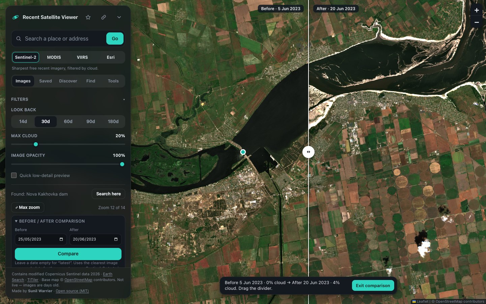
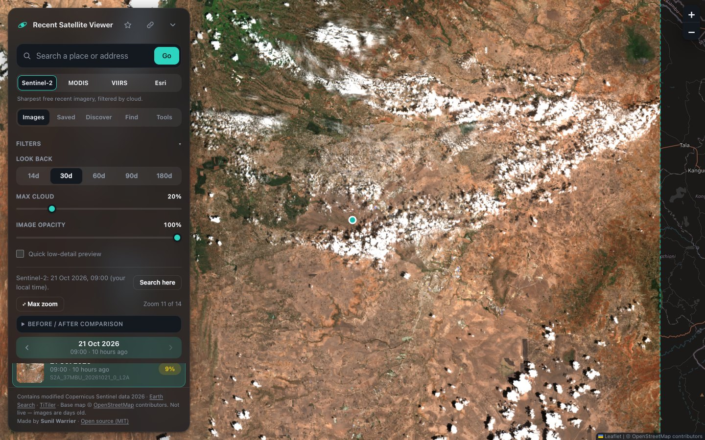
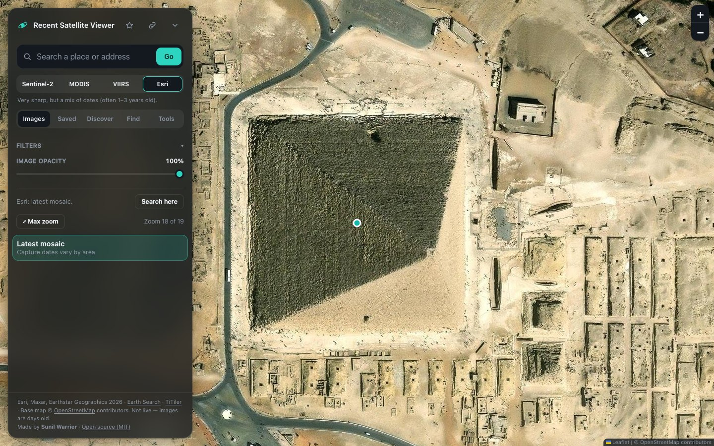
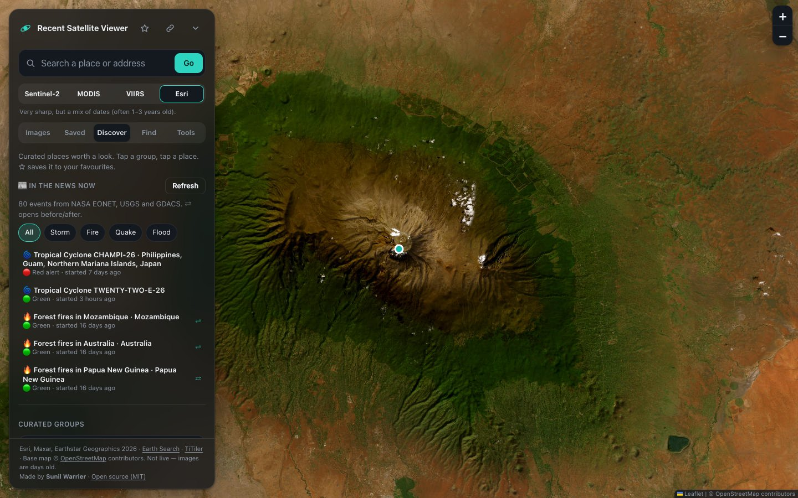
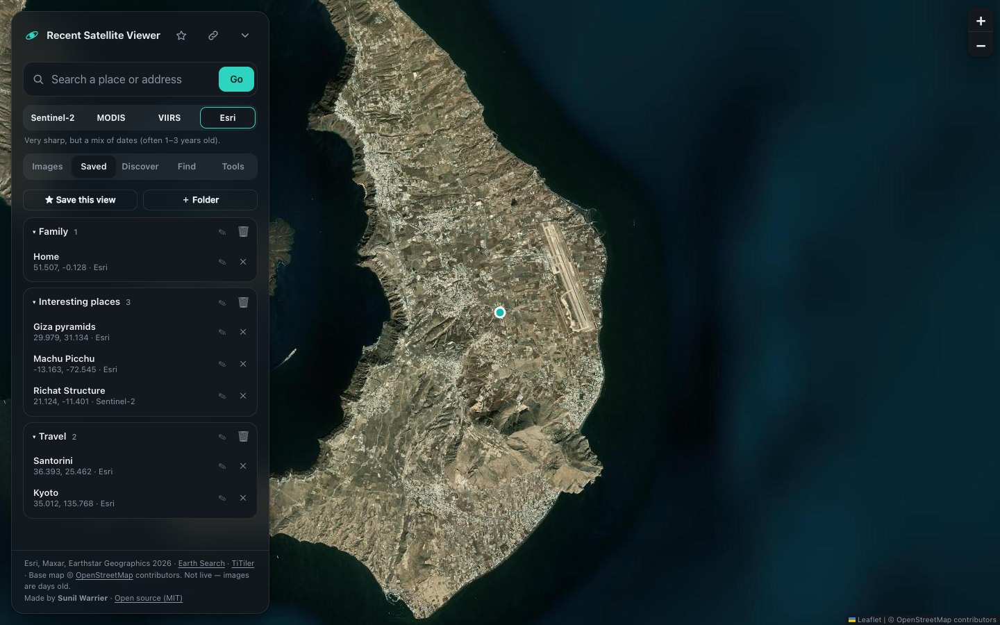
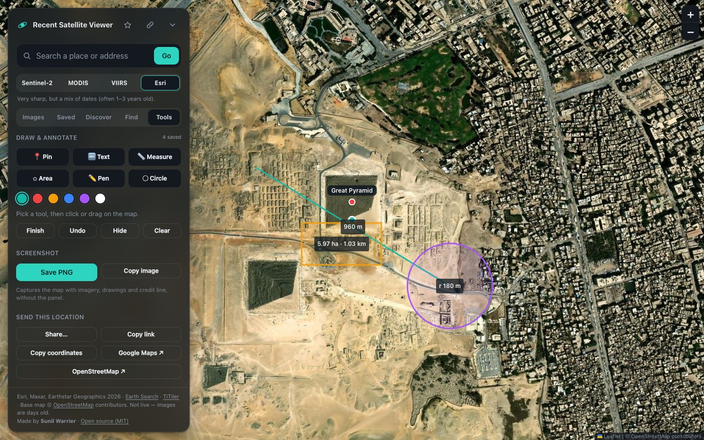
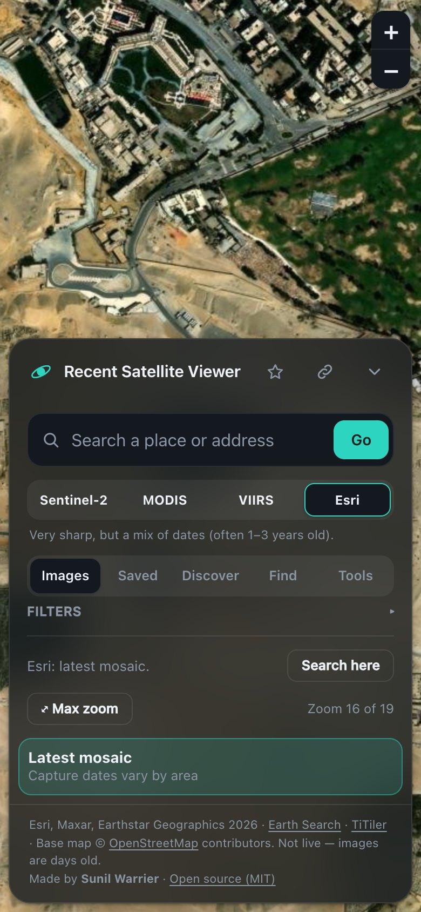

# Recent Satellite Viewer

Search any place, see its most recent clear Sentinel-2 satellite passes, step back through dates. Free data, no API keys. Built from [docs/SPEC.md](docs/SPEC.md) (v1 + v1.1: shareable URL, date stepper with ←/→ keys, auto re-search on pan, self-hosted tiler).



<table>
  <tr>
    <td><br><sub><b>Latest Sentinel-2</b> with cloud filter and date stepper</sub></td>
    <td><br><sub><b>Esri high-res</b> up to zoom 19</sub></td>
  </tr>
  <tr>
    <td><br><sub><b>Discover</b>: live events and curated groups</sub></td>
    <td><br><sub><b>Saved</b> places in folders</sub></td>
  </tr>
  <tr>
    <td><br><sub><b>Tools</b>: draw, measure, pin, screenshot, share</sub></td>
    <td><br><sub><b>Phone</b> layout</sub></td>
  </tr>
</table>

## Imagery sources (switch in the panel)

| Source | Detail | Dates | Notes |
|---|---|---|---|
| Sentinel-2 | 10 m | every ~5 days, cloud filter | via Earth Search + TiTiler |
| MODIS (NASA) | 250 m | daily, up to yesterday | NASA GIBS, no key |
| VIIRS (NASA) | 375 m | daily, up to yesterday | NASA GIBS, no key |
| Esri | <1 m | archive, mixed dates | zoom up to 19; check Esri terms for public use |

**Max zoom** jumps to each source's real detail limit; beyond it the app enlarges tiles and warns. Landsat was left out: its files are requester-pays on AWS, so it needs an AWS account.

New source = one entry in `src/sources.ts`.

## Features

- **Search** with autocomplete and typo tolerance (Photon). Press Enter to take the best match. Pasted coordinates and map links also work.
- **Before / after**: swipe between two dates with a draggable divider (Images tab, or any ⇄ place). Picks the clearest image near each date.
- **In the news**: live events from NASA EONET, USGS (M5+ earthquakes) and GDACS (floods, cyclones, volcanoes, fires), refreshed on demand. ⇄ events open a comparison from before the event to now.
- **Saved**: favourite places in folders (Family, Interesting places, Travel, or your own). Drag places between folders. Stored in the browser.
- **Discover**: 16 curated groups, including conflict zones with before/after dates (Ukraine, Gaza, Iran/Israel, Middle East, Africa) and historic battlefields (wildlife, volcanoes, deserts, cities, ancient world, megaprojects, changing planet, airports, farms, lakes). Save a whole group as a folder.
- **Find**: highlight houses, lakes, rivers, pools, parking lots, roads, forest, farmland, pitches, airports, solar/wind and zoos in the current view. Data is OpenStreetMap via Overpass (three mirrors, so it may be slow). It is map data, not AI detection: cars and animals themselves are not detected.
- **Tools**: pins, text, measure distance, measure area, freehand pen and circle, with colours; screenshot to PNG or clipboard (includes drawings and a credit line); send a location (share, link, coordinates, Google Maps, OpenStreetMap); open a received location; export/import everything as one JSON file.

## Develop

```bash
npm install
npm run dev      # http://127.0.0.1:5173
npm test
npm run build    # static site in dist/
```

## Host

**Option A — Docker (recommended).** nginx serves the app, proxies and caches the geocoder, and talks to a self-hosted TiTiler.

```bash
docker compose up -d --build     # http://localhost:8080  (PORT=80 to change)
```

Put it behind your TLS reverse proxy (Caddy, Traefik, Cloudflare Tunnel) for a public domain.

**Option B — static host** (Netlify, Vercel, Cloudflare Pages, S3). Build with `npm run build`, upload `dist/`. Uses the public `titiler.xyz` demo and Nominatim directly: fine for personal use, not for heavy traffic.

## Configuration

All service URLs are in `src/config.ts`, overridable at build time (see `.env.example`): `VITE_TILER_URL`, `VITE_GEOCODER_URL`, `VITE_GEOCODER_BACKUP_URL`, `VITE_STAC_URL`, `VITE_BASEMAP_URL`.

## Before going public

- OSM tiles and Nominatim are for light use. For a busy site use a tile provider with a key and a self-hosted or paid geocoder.
- Keep the Copernicus Sentinel and OSM attribution visible (already in the panel footer).
- Imagery is not live: 1–5 days old at best, 10 m per pixel.

## Credits and licence

Made by **Sunil Warrier**. Released under the [MIT licence](LICENSE): free to use, copy, modify and share for any purpose, including commercial, as long as the copyright notice stays.

Data and services: Copernicus Sentinel data (via Earth Search / Element 84, TiTiler), NASA GIBS, Esri World Imagery, OpenStreetMap contributors, Photon (komoot), NASA EONET, USGS, GDACS. Check each provider's terms before heavy or commercial use.
